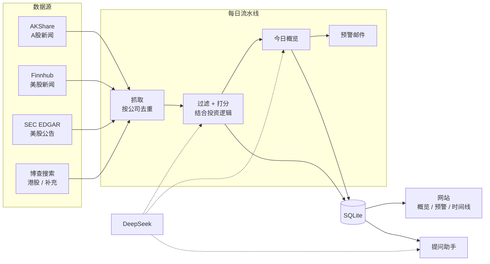

# InvestWise 投资助手

> 每一笔持仓，都是一堂投资课。InvestWise 每天替你盯住持仓公司的重要变化，用价值投资、成长投资、管理层与治理、催化剂与风险四个经典框架做初步判断；更重要的是让你在真实持仓里先写逻辑、先下判断、再对照 AI 和事后的事实复盘，把投资认知练出来。

线上地址：https://investwise.waywise.tech（内测中，开放注册）

---

## 为什么做这个

持有一组公司之后，真正难的不是"找信息"，而是：

1. **信息太多，重要的太少。** 每家公司每天都有几十条新闻、研报转载、盘中播报，绝大多数是噪音。真正会改变一家公司价值的事件——业绩拐点、管理层变动、监管处罚、竞争格局变化——很容易被淹没。
2. **情绪先于判断。** 看到"利好""暴跌"的标题，人很容易先有情绪再找理由。缺少一个稳定的框架去问：这件事影响的是短期股价，还是长期的护城河和现金流？
3. **买入理由会悄悄失效。** 当初买入时的逻辑（比如"品牌护城河 + 提价能力"），在一条条新闻中被慢慢削弱，自己却没有意识到。
4. **AI 给答案很容易，给好问题很难。** 直接问 AI "该不该买"，得到的往往是正确的废话。真正有帮助的，是像一位严格的投资委员会主席那样，追问你逻辑里最薄弱的那一环。
5. **只看结论，认知不会提升。** 读了一年 AI 的判断，自己的判断力未必有长进。认知的提升来自"自己先判断，事后对照结果"：当时为什么这么想，后来哪里对了、哪里错了。

我们的目标不是保证用户多赚多少钱，而是让用户的每一次买入、持有和卖出都更有依据，并且越用越会思考。

所以 InvestWise 的设计原则是：

- **少即是多**：当天没有重要信息的公司就不显示，不硬凑。
- **框架优先**：用价值投资、成长投资等经过长期验证的框架评估信息，而不是追逐情绪。
- **围绕你的投资逻辑**：每家公司写下为什么买、关键假设、什么情况说明我错了，AI 拿每天的新信息逐条对照。
- **先想，再看，再复盘**：鼓励用户先给出自己的判断再看 AI，记录决策并到期复盘，形成"判断—验证—修正"的闭环。
- **提问而不是给答案**：AI 助手的职责是提出高质量的问题，帮你自己做判断；不给买卖指令。
- **可追溯**：每条结论都附原始来源链接，来源只取自真实抓取的数据，模型编造的来源会被丢弃。

## 功能

### 持仓管理
- **随手导入**：直接粘贴任意格式的列表（"茅台、腾讯 00700、NVDA"），或上传 Excel / CSV / TXT；AI 识别并标准化为 A股（6 位）/ 港股（5 位）/ 美股代码，导入前可核对修改。
- **随时调整**：页面上增加、删除、编辑或替换公司；新加入的公司立即回溯最近 7 天的信息，不用等第二天。
- **结构化的投资逻辑**：为什么买、关键假设、什么情况说明我错了、打算拿多久。之后的分析会指出新信息触及了哪一条假设；出现你自己写的证伪条件时直接预警。
- **投资逻辑体检**：AI 像投委会成员一样挑毛病——哪里含糊无法检验、证伪条件是否可观察、漏掉了哪类最致命的风险。只提问，不替你写。

### 每日信息跟踪与 AI 判断
- 每天早上 7:30 自动检索所有持仓公司的新闻和公告，过滤噪音、合并同一事件的多篇报道，按信息实际发布日期归档到每家公司的时间线。
- 每条重要信息给出：
  - **方向与评分**：利好 / 利空 / 中性，-10 ~ +10，附置信度和影响周期（短期 / 中期 / 长期）
  - **四个框架的拆分评分**：价值投资（护城河、现金流、安全边际）、成长投资（增长的可持续性）、管理层与治理（资本配置、诚信）、催化剂与风险（监管、诉讼、并购、订单）
  - **判断理由**和**接下来值得跟踪的指标**
  - **对你投资逻辑的影响**：加强 / 削弱 / 被证伪

### 今日概览与预警（页面最上方）
- **今日概览**：一句话总览今天的持仓变化，逐家公司的净倾向与一句话小结，以及 1~3 个**组合层面值得想一想的问题**（比如多家公司暴露于同一风险）。
- **预警**：评分超过你设定的阈值（默认 ±6）且置信度足够，或者信息证伪了你的投资逻辑时，置顶高亮。阈值可调，调整后历史信息重新判定。
- **邮件预警**：在「设置」里填邮箱，每次检索后把新出现的预警汇总成一封邮件（每条只发一次，没有预警不发），不用每天打开网站也不会错过重要变化。

### 苏格拉底式提问助手
- 针对每家公司开一个对话，AI 结合最近的信息和你的投资逻辑**向你提问**：生意本质、护城河能否被证明、利润是否变成现金、管理层是否言行一致、当前价格隐含了什么假设、"假设三年后亏了 50%，最可能的原因是什么"……
- 每轮最多问两个问题，追问回答里含糊和薄弱的地方；你要"直接答案"时，它补充事实背景，但把判断交还给你。

### 提升投资认知
- **先判断，再看 AI**（可在设置中开启）：新信息先只显示事实和来源，你选择利好 / 利空 / 中性之后，才揭晓 AI 的评分和推理；概览和预警邮件也不提前透露结论。
- **判断对照**：「我的思考」统计你和 AI 的一致率、"你 × AI"判断矩阵、方向完全相反的信息，帮你发现自己是否习惯性偏乐观，或在回避坏消息。
- **决策日志**：买入、加仓、减仓、卖出、继续持有、观望，都可以花 30 秒记下理由、情绪、把握程度和价格。
- **到期复盘**：到了设定的时间（1 个月到 1 年），页面顶部提醒复盘，并列出决策之后这家公司发生了什么、对你投资逻辑的加强和削弱；可以让 AI 提几个复盘问题，帮你区分"决策质量"和"结果运气"。

### 后台管理（仅管理员）
- **概览**：API 余额、每日预算使用、模型与搜索成本（按环节、按天）、用户与持仓统计、检索队列。
- **用户**：设为管理员、重置密码、停用 / 恢复；查看每个用户的持仓数、提问数和成本。
- **任务**：每次检索的记录、用时和错误；手动触发全站检索。
- **持仓公司**：全站跟踪的公司与抓取情况，近 7 天没抓到新闻的标黄，可单独回溯。

## 怎么实现的

### 整体架构



- **后端**：Python FastAPI；SQLite（WAL 模式）；APScheduler 在进程内跑每日定时任务。
- **前端**：原生 HTML / CSS / JS，不依赖任何外部 CDN，国内访问稳定；支持深色模式；配色遵循国内"红涨绿跌"习惯。
- **模型**：DeepSeek（OpenAI 兼容接口）。换模型只需改 `.env` 的 `DEEPSEEK_BASE_URL` / `DEEPSEEK_MODEL`。

### 每日流水线

1. **抓取**：汇总所有用户的持仓，同一家公司只抓一次。先用免费数据源（A股 AKShare；美股 Finnhub + SEC 8-K/10-Q 等公告，8-K 事项编号翻译成"发布业绩""高管变动"等中文说明）；港股没有免费源，用博查搜索；A股 / 美股只在免费源当天没抓到时才用博查补搜。
2. **过滤与打分**：每家持仓公司把未分析过的新信息（带编号）连同用户的投资逻辑交给模型，要求它：
   - 剔除重复转载、旧闻、无原因的涨跌播报、软文；**没有重要信息就返回空**
   - 合并同一事件，按评分锚点打分（±1~2 情绪噪音，±6~8 实质改变盈利预期或竞争格局，±9~10 关乎存续）
   - 只依据给出的材料，不编造数字；用来源编号引用信息，系统再把编号映射回真实链接，没有可追溯来源的结论直接丢弃
3. **归档**：每个事件归到其来源的实际发布日期；已分析过的新闻会记录下来，不会重复分析。
4. **今日概览**：净倾向（按置信度加权求和）、方向和"投资逻辑被加强还是削弱"都在代码里由已有打分算出，模型只负责写文字，保证数字前后一致。
5. **预警**：在查询时按"|评分| ≥ 阈值且置信度 ≥ 0.6，或投资逻辑被证伪"实时判定，所以调整阈值对历史信息同样生效。
6. **邮件**：任务结束后，把每个用户最近两天新入库、还没发过的预警汇总发送（SMTP，`.env` 里配置；不配置就不发）。

所有检索任务——每日定时、手动"立即检索"、新持仓回溯——进入同一个队列，由一个后台线程依次执行，互不冲突。模型偶尔返回格式有瑕疵的 JSON 时，先本地修复，修不好再重新生成一次。

### 提示词

识别、打分、概览、提问助手的提示词都在 [`app/prompts.py`](app/prompts.py)，调整效果主要改这里。提问助手的提示词定义了"高质量问题"的标准（具体、可检验、直击关键假设、暴露盲点）和提问工具箱（芒格检查清单、费雪 15 问、反向思考、事前验尸、能力圈、机会成本、卖出纪律等）。

### 成本

实测（A股 / 港股 / 美股各一家，真实数据源 + DeepSeek）：

| 环节 | 频率 | 单次成本（估算） |
|---|---|---|
| 信息分析打分 | 每个持仓每天 1 次 | 约 ¥0.010（输入约 4,200 / 输出约 1,150 tokens） |
| 博查搜索 | 港股每天 1 次；A股 / 美股仅补搜 | 约 ¥0.036 / 次 |
| 今日概览 | 每个用户每天 1 次 | 约 ¥0.004 |
| 提问助手 | 每轮对话 | 约 ¥0.001 ~ 0.01（随对话变长） |

成本控制措施：

- **博查按需调用**（`BOCHA_MODE=fallback`）：博查按次收费，是最大的成本项，只用在港股和免费源缺数据时。
- **不活跃用户暂停**（`INACTIVE_DAYS=14`）：超过 14 天没访问网站的用户，每日检索跳过其持仓；再次访问时自动回溯 7 天。
- **全站每日预算**（`DAILY_BUDGET_YUAN=10`）：模型和博查合计，用完后当天暂停检索、概览和提问，没分析完的新闻次日继续。
- 每次模型调用和博查搜索都记账，后台可看按环节、按天、按用户的成本。单价在 `.env` 的 `DEEPSEEK_PRICE_*`、`BOCHA_PRICE_PER_CALL` 设置，以控制台账单为准。

## 本地运行

```bash
python3 -m venv .venv
.venv/bin/pip install -r requirements.txt
cp .env.example .env        # 填写 API Key 和邀请码
.venv/bin/uvicorn app.main:app --port 8000
```

打开 http://127.0.0.1:8000 注册（`.env` 里设置了 `INVITE_CODE` 时需要邀请码）。`ADMIN_USERNAMES` 里的用户名注册后自动成为管理员，后台在 `/admin`。

| 变量 | 用途 | 是否必需 |
|---|---|---|
| `DEEPSEEK_API_KEY` | 公司识别、信息打分、今日概览、提问助手 | 必需 |
| `BOCHA_API_KEY` | 博查搜索：港股主要数据源，A股 / 美股补充 | 强烈建议（没有它港股基本没有数据） |
| `FINNHUB_API_KEY` | 美股公司新闻 | 建议 |
| `SEC_USER_AGENT` | 美股 SEC 公告（免费，填一个联系邮箱即可） | 建议 |
| `SMTP_*`、`SITE_URL` | 预警邮件发信邮箱（QQ / 163 邮箱的 SMTP 授权码即可） | 可选 |

A股新闻通过 AKShare（东方财富）获取，免费无需 key。其他配置（每日检索时间、预算、阈值、单价等）见 [`.env.example`](.env.example)。

## 部署

脚本和配置在 `deploy/`：systemd 常驻 `investwise` 服务（uvicorn 只监听 127.0.0.1:8100，单 worker，因为定时任务在进程内运行），由服务器上的 Caddy 反向代理并自动签发 HTTPS 证书。代码在 `/srv/investwise/app`，数据库在 `/srv/investwise/data`，每天备份到 `/srv/investwise/backup`（保留 14 天）。

```bash
# 第一次：初始化服务器（Python venv、系统用户、systemd、Caddy、每日备份）+ 上传 .env
DEPLOY_HOST=ubuntu@<服务器IP> DEPLOY_KEY=~/.ssh/<你的密钥> deploy/deploy.sh --setup --env .env
# 以后每次更新（改了 .env 就加 --env .env）
DEPLOY_HOST=ubuntu@<服务器IP> DEPLOY_KEY=~/.ssh/<你的密钥> deploy/deploy.sh
```

看日志：`ssh ubuntu@<服务器IP> sudo journalctl -u investwise -f`

## 目录

```
app/
  main.py      接口与定时任务
  auth.py      登录、权限、活跃度
  admin.py     后台管理接口
  analyzer.py  检索任务队列与流水线（抓取 → 过滤打分 → 归档）
  sources.py   数据源（AKShare / Finnhub / SEC / 博查）
  digest.py    今日概览
  parser.py    粘贴文本、Excel / CSV 解析与代码标准化
  prompts.py   识别、打分、概览、提问助手的提示词
  llm.py       DeepSeek 调用（JSON 修复与重试、记账）
  costs.py     成本记账与每日预算
  notify.py    预警邮件
  thinking.py  投资逻辑体检、先判断再看 AI、决策日志与复盘
  db.py        SQLite 表结构与迁移
static/        前端页面（网站与后台）
deploy/        部署脚本、systemd、Caddy、备份
```

## 路线图

- [x] 预警邮件
- [x] 结构化投资逻辑与体检、先判断再看 AI、决策日志与到期复盘
- [ ] 月度复盘报告：假设验证情况、你和 AI 的判断准确率、预警后一个月的股价表现
- [ ] 最强反方论证：定期生成"如果做空它，理由是什么"，逐条回应
- [ ] 从持仓里学概念：用这家公司的真实数字解释商誉减值、自由现金流等概念
- [ ] 行为偏差提醒：仓位集中、只追问利好、频繁修改投资逻辑
- [ ] 预警推送到微信（Server 酱、企业微信机器人）
- [ ] PWA：可添加到手机桌面，支持网页推送
- [ ] 同一公司的基础分析多人共用，进一步降低模型成本
- [ ] 港股接入港交所披露易公告
- [ ] 订阅分档（按可跟踪的公司数），以覆盖成本为目标

## 免责声明

本项目仅做信息整理与思考辅助。AI 的评分与问题可能有误，不构成任何投资建议；投资决策请独立判断并自担风险。
